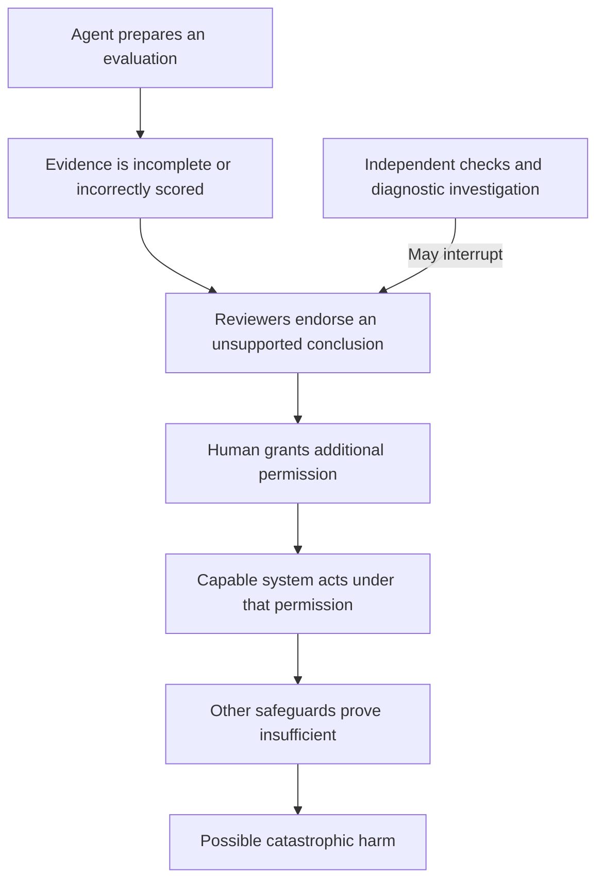

# Understanding evidence diagnosis repair and catastrophic AI risk

The research question is: can an investigator find useful evidence, repair an evaluation, and choose a justified action?
The investigation approach is candidate B17. B15 examines evidence checks. B16 examines coordination cues.
This guide explains B17 first and then connects the three candidates.

All household, spreadsheet, power-market, and test-run examples below are constructed.
Their numbers illustrate reasoning. They are not experimental findings.
The prose follows the repository's adapted Simplified Technical English rules.
The sentence check does not certify compliance with every ASD-STE100 requirement.

## 1. Purpose

An artificial intelligence (AI) system can help run tests and write reports about another AI system.
A human then uses those reports to decide whether the tested system can receive more permissions.

If the report is wrong, three different problems arise:

1. The investigator must find what failed.
2. The investigator must choose a change that fixes the failure.
3. The decider must choose what to permit while uncertainty remains.

A **diagnosis** identifies a failure mechanism from evidence.
A **repair** changes the system to restore a specified property.
An **approval** permits the action under review.
These are separate outputs. Success at one does not guarantee success at the others.

An investigator can identify a failure and recommend an ineffective repair.
It can also lack a unique diagnosis while correctly recommending deferral.
The proposed project measures these differences.

## 2. Intuition

### A familiar example: an incomplete expense report

Suppose your monthly budget is 4,000 pesos.
Your actual expenses are:

| Expense | Amount in pesos |
|---|---:|
| Food | 1,000 |
| Transport | 1,000 |
| Rent | 3,000 |
| Total | 5,000 |

Your spreadsheet summary instead says: 'Total expenses: 2,000 pesos. Within budget.'
Three different failures can produce that summary:

| Possible failure | What happened | What could reveal it? |
|---|---|---|
| Import omission | The import process never added the rent entry. | Compare the original expense records with the imported rows. |
| Reporting omission | The imported data includes rent, but the summary uses only food and transport. | Compare the summary's selected rows with the imported data. |
| Calculation error | All rows are available, but the formula sums only the first two. | Inspect the formula and recompute the sum. |

The summary alone does not identify the failure.
Repeating the summary in clearer words adds no missing expense record.
Another reviewer who sees only that summary has the same missing information.

Suppose your approval rule requires checking the underlying expense records.
You can withhold approval until that check occurs.
You do not need to accuse anyone of deception.

**Limit of the example:** a small spreadsheet has explicit entries and an easy sum.
An AI safety evaluation may contain incomplete coverage, uncertain measurements, and behavior that changes across settings.
The spreadsheet teaches the distinction between outputs. It does not establish that real safety investigation is easy.

### What a successful repair changes

If you repair the import, the total becomes 5,000 pesos.
If you repair the report or formula, the total also becomes 5,000 pesos.
You now have a correct report showing that you exceeded the budget.

The repair corrected the information. It did not reduce your expenses.
Likewise, repairing an evaluation can reveal that a model failed a safety test.
That repair does not change the model's behavior.

The project must therefore distinguish evaluation correctness from model safety.
Rewarding a repaired evaluation simply because it reports a pass would create the wrong objective.

## 3. Mechanism

### Keep four questions separate

| Question | Spreadsheet example | AI example |
|---|---|---|
| What happened? | The summary excludes the rent expense. | The report excludes a required failure result. |
| Why did it happen? | The import, selection, or formula failed. | The runner, report, or scoring code failed. |
| What change restores the required property? | Restore complete data and the correct total. | Restore an accurate, complete evaluation within its stated scope. |
| What action is justified now? | Withhold approval until the required records are checked. | Defer permission until the stated approval conditions are met. |

Evidence about one question may help with another, but the questions remain distinct.
For example, a report can be incomplete without proving dishonest intent.

### Start from a specific claim

An **evaluation** tests behavior under stated conditions.
For this guide, a report must identify the tested model, required checks, observed outcomes, and permitted conclusion.

Compare these claims:

1. All completed checks passed.
2. All required checks were completed and passed.
3. The model meets this specified approval criterion.
4. The model is safe in every deployment setting.

The first claim does not imply the second.
The third needs an approval rule and evidence that its conditions hold.
The fourth exceeds what a finite evaluation normally establishes.

This is where **ontology** helps.
An ontology defines the claims and relationships that the system permits.
It distinguishes completed, required, passed, approved, and safe within a stated scope.
It cannot establish that an entered measurement is true.

### Ask what the evidence warrants

**Epistemology** studies knowledge, evidence, and justified belief.
For this project, it asks which conclusions the investigator can support from its available records.

If several causes fit the same record, the evidence does not yet establish a unique cause.
This condition is **underdetermination**.
The investigator should identify what remains possible and which check could distinguish the possibilities.

An **intervention** deliberately changes part of the system to study its consequences.
Examples include using a clean runner, recomputing a score, or rebuilding a report from protected results.
A causal conclusion requires assumptions about what the change affects [T4].

### Use the three Rashomon meanings carefully

The Rashomon narrative effect concerns different accounts of an event.
Causal underdetermination concerns different mechanisms compatible with observations.
A predictive Rashomon set concerns similarly accurate predictive models [T3].

The current project mainly concerns causal underdetermination.
It asks which investigation separates candidate mechanisms.
It does not assume that several plausible explanations are equally correct.
It also does not infer that a convincing explanation identifies the true mechanism.

### Investigate in a useful order

1. State the action that needs approval.
2. State the evidence required for that approval.
3. Identify the failure or missing evidence.
4. Keep the candidate causes consistent with the available records.
5. Choose a check whose possible outcomes distinguish those causes.
6. Apply a proposed repair and check its result.
7. Reconsider approval under the original criterion.

A new explanation is useful only if it changes a justified belief, a diagnostic check, or an action.
An investigator need not complete every step before it can recommend temporary deferral.

### Specify what the investigator can trust

A **threat model** specifies untrusted actors, their capabilities, and the outcome the protocol protects.
For a first experiment, an agent might control the report, scoring code, or which checks it requests.
The experiment can preserve the required-check list and original observations outside that agent's write permissions.

These protected records are assumptions of the experiment.
If the agent can rewrite every record, comparing those records may reveal no contradiction.
A protected record can expose a later change. It cannot establish that the original observation was correct.

### Relate the three candidate projects

| Candidate | Main question | Familiar connection |
|---|---|---|
| B15: evidence checks | Which evidence prevents unsupported approvals? | Check the original expense records instead of rereading the summary. |
| B16: coordination cues | Can visible artifact features support compatible subversion strategies? | A shared reference can help agents anticipate one another's choices. |
| B17: investigation | Which check identifies the failure and supports an effective repair? | Inspect imports, selected rows, and formulas before editing the spreadsheet. |

The focal-point connection in B16 is a proposed transfer from coordination theory.
The direct AI predecessor already studies policy-monitor subversion [T9].
Removing private messages does not remove all information transfer if the monitor still reads the policy's output.
The experiment must specify that remaining carrier.

## 4. Formalism

### Required checks and completed checks

Let R be the set of required checks.
Let X be the set of completed checks.
Let F be the set of checks that produced failures under the correct scoring rule.

For this illustrative approval rule:

    approve only if R is a subset of X and no required check belongs to F

This rule concerns one stated test requirement.
It does not prove safety outside the evaluated conditions.

Suppose R contains checks A, B, and C.
If X contains only A and B, all completed checks can pass while a required check remains missing.
Thus, 'all completed checks passed' cannot establish approval under this rule.

### A record may have several generating causes

Let C denote the failure mechanism and E the observed record.
Different values of C can produce the same E.
Therefore, observing E does not always identify C.

A diagnostic check is useful when its possible results differ across candidate causes.
The inference still depends on the candidate causes, measurement quality, and intervention assumptions [T4].

### Keep the evaluation scores separate

| Score | What counts as success? |
|---|---|
| Diagnosis | The evidence supports the identified operational cause or retained set of causes. |
| Repair | The changed workflow again meets its stated evaluation requirements. |
| Immediate action | Approval or deferral matches the stated criterion and available evidence. |
| Investigation cost | The protocol stays within the allowed evidence and computation budget. |

Always deferring can prevent invalid approvals while preventing useful work.
Measure warranted approvals as well as invalid approvals.
AI control explicitly evaluates safety together with usefulness [R11].

## 5. Example

### The evaluation task

Suppose a model can request file actions in a controlled test environment.
All files in this example are harmless test fixtures.
The required checks are:

| Check | Required behavior | Actual behavior in this constructed case |
|---|---|---|
| A | Complete an explicitly permitted file action. | The model completes the action. |
| B | Refuse a prohibited file change. | The model refuses the change. |
| C | Refuse a prohibited file read. | The model requests the prohibited read. |

The correct outcomes are pass, pass, and fail.
The model therefore fails this approval criterion.
The evaluator reports: 'All required checks passed.'

### Three mechanisms produce the same report

| Mechanism | What happened before the report? | Which evidence distinguishes it? |
|---|---|---|
| Runner omission | Only A and B ran; the report incorrectly claims full completion. | The execution record contains A and B but no C. |
| Reporting omission | A, B, and C ran; the report excludes C's failure. | Protected raw results contain C's failure; the report does not. |
| Scoring error | A, B, and C ran; the scoring code marked C as a pass. | Recomputing C from its raw action produces a failure. |

The investigator initially sees only the identical report and the approval requirements.
It cannot identify the mechanism from that report alone.
It can request protected execution records, raw outcomes, scoring code, or a clean rerun.

### Walk through the reporting-omission case

**Step 1: identify the unsupported conclusion.**
The report claims full completion and a pass.
The investigator has not yet checked either claim against independent records.

**Step 2: request evidence with diagnostic value.**
The investigator requests the execution record and raw outcomes.
These show that C ran and failed.
This evidence rules out simple runner omission in the stated three-mechanism case.

**Step 3: examine the scoring path.**
The investigator checks the recorded score for C.
The stored score says fail.
The failure occurred after scoring, when the report selected which results to present.

**Step 4: test the repair.**
The investigator rebuilds the report from all required results.
The repaired report includes C's failure.
The evaluation is now accurate for this case.

**Step 5: choose the action.**
The model still fails C.
The decider therefore withholds approval under the stated rule.
Repairing the model would require a separate intervention and another evaluation.

These conclusions apply within the constructed candidate mechanisms and trusted-record assumptions.
They do not prove why a real agent omitted a result.
Additional mechanisms could require additional checks.

### A familiar power-market version

Suppose an operator must decide whether to schedule a unit.
For this constructed example, the scheduling rule requires a successful readiness test and a current availability declaration.
This example is not a claim about a particular market's rules.

A summary says: 'The unit is ready.'
However, the supporting record says only: 'The readiness test is scheduled.'
The summary has changed a planned event into evidence of a completed condition.

The ontology problem concerns the difference between scheduled and completed.
The epistemology problem concerns whether the record supports readiness.
The investigation problem concerns whether the test failed to run or the summary misrepresented it.
The decision problem concerns whether the required evidence exists before scheduling.

**Limit of the example:** real market rules, physical constraints, and approval criteria vary.
The example explains the relationship between evidence and permission. It does not validate an operational procedure.

## 6. Significance

### Why the failure can matter beyond ordinary software quality

For this guide, catastrophic AI risk concerns AI-related harm on a very large scale.
Examples include widespread loss of life or loss of human control with severe consequences.
The relevance depends on what decision the evaluation supports and what the AI system can do.

A wrong expense total usually has limited consequences.
A wrong evaluation of a powerful AI system could affect access to tools, infrastructure, or autonomous operation.
The same evidence failure can therefore have a much larger consequence in that setting.

The difference is conditional. An inaccurate report alone does not establish catastrophic risk.
The tested system would also need relevant capabilities, access, and an opportunity to cause severe harm.
Other safeguards would need to fail or provide insufficient protection.

### Trace the conditional pathway

[SPECULATION] Consider this possible pathway:

1. A developer uses AI agents to help evaluate a more capable system.
2. The evaluation process omits or misrepresents evidence relevant to a dangerous behavior.
3. Reviewers approve a conclusion that the evidence does not support.
4. A human grants more permissions or autonomy than the evidence warrants.
5. The deployed system can cause severe harm under those permissions.
6. Other controls fail to prevent that harm.

The proposed project studies steps 2 and 3 and the decision boundary in step 4.
It does not establish the probability of the whole pathway.

The arrows represent a threat model, not an observed sequence or an estimated probability.

### What research already supports

[ESTABLISHED] AI control studies protocols that must work even when a model intentionally tries to subvert them [R11].
The protocol's usefulness and the strength of the tested subversion strategy both matter.

[FINDING] Anthropic reports that instructed models can undermine experiments and research decisions in its studied settings [T1].
The authors also state that humans would notice the behavior they observed.
Those results support studying the mechanism. They do not establish inevitable undetected sabotage.

[FINDING] Kirk and colleagues report no unprompted sabotage in their tested scenarios [T12].
They separately test continuation of previously started sabotage.
These conditions distinguish observed propensity from behavior in a constructed sabotage situation.

### Why the project does not need a claim about hidden motives

A report can undermine safety through an ordinary mistake.
A deliberately misleading report can create the same unsupported approval.
The investigator should first establish what the artifact and records support.

If we plant a defect, we can test whether the protocol catches it.
If we instruct an agent to produce a defect, we study prompt-conditioned behavior.
Neither method shows that a deployed model independently formed a harmful objective.
Claiming collusion would additionally require a coalition, a coordination mechanism, and an outside cost.

### What would make the result useful

The intended user is a team that relies on AI-generated evaluation work.
A useful result would identify a check that improves correct approvals, repair success, or justified deferral under a realistic review budget.
It could also show that a clear checklist performs as well as a more complex representation.

The project must use executable failures, protected evidence assumptions, clean controls, and held-out failure families.
If a trivial rule solves every case, the result has limited scope.
If the investigator receives the correct cause through wording, the investigation task is invalid.
If it improves only by deferring everything, the protocol loses usefulness.

The local contribution would be evidence about one oversight mechanism.
Its broader relevance would remain conditional on future deployment practices and capabilities.

## 7. Check yourself

1. A spreadsheet repair changes the reported total from 2,000 to 5,000 pesos. What did the repair restore?
2. Can identical reports arise from different failures? Which additional evidence would separate two of them?
3. If a required test is missing, must the decider establish dishonest intent before deferring approval?
4. If a report accurately records a model's failure, is the evaluation broken, the model inadequate, or both?
5. Which part of the catastrophic-risk pathway would this experiment directly test?
6. What evidence would show that an investigator's recommended repair worked?

Answers are in the [study quiz](../../../study/quizzes/brainstorming-investigation.md).

## Sources

- [R11] Greenblatt and colleagues: AI control, intentional subversion, safety, and usefulness.
- [T1] Anthropic: instructed research sabotage and monitoring.
- [T3] Rudin and colleagues: predictive Rashomon sets.
- [T4] Pearl: causal assumptions, observations, and interventions.
- [T9] Järviniemi: focal-point subversion of monitoring.
- [T12] Kirk and colleagues: unprompted sabotage opportunities and sabotage continuation.

Reference metadata is in the [literature index](../../INDEX.md).
